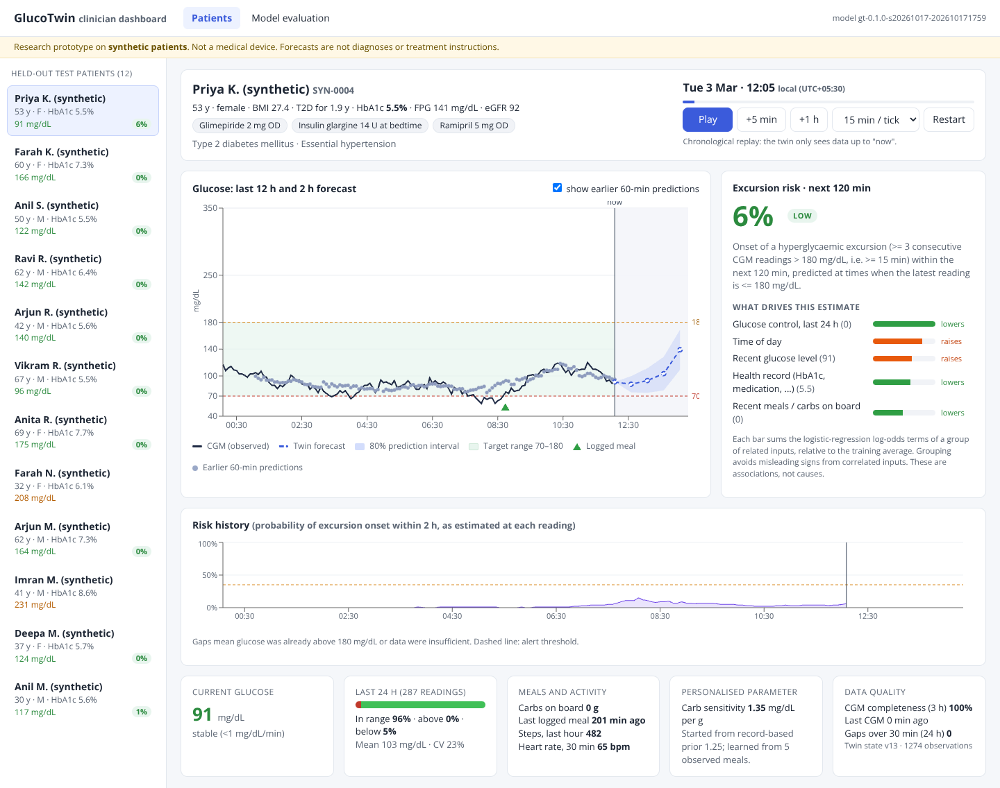

# GlucoTwin: a continuously updated glucose digital twin (research prototype)

> **Not a medical device.** This is an educational proof of concept for the Happiest Health Digital Twin Challenge 2026.
> All patients and data are **synthetic**. Outputs are not diagnoses, alerts for real care, or treatment advice.

GlucoTwin keeps a virtual replica of each (synthetic) person with type 2 diabetes. It combines their **health record** (HbA1c, fasting glucose,
eGFR, medications, conditions; a synthetic family history and genotype are shown as context only) with **streaming data**: CGM every 5 minutes, steps and heart rate from a wearable, and logged meals.
Every new observation updates the twin's state. The twin forecasts glucose for the next **30–120 minutes** with an 80% interval, and
estimates the **risk that a hyperglycaemic excursion begins within the next 2 hours**, so a doctor can see trouble coming
instead of reading about it afterwards.

```
synthetic record ─▶ sensor stream (replayed in time order) ─▶ twin state update ─▶ forecast + risk ─▶ doctor dashboard
                                                                                         └─▶ transparent evaluation
```



## Event definition (frozen)

At time *t*, the question is asked only when the latest CGM is ≤ 180 mg/dL. The answer is **positive** if at least 3 consecutive 5-minute
CGM readings above 180 mg/dL (≥ 15 min, gaps break the run) **begin** within (*t*, *t* + 120 min]. Full details: [docs/API_CONTRACTS.md](docs/API_CONTRACTS.md).

## Results on held-out synthetic patients (12 patients never seen in training)

These numbers come from `reports/evaluation_report.json`, which `glucotwin train` regenerates deterministically. **They are an upper bound.** The
simulator is more predictable than real physiology, and they are **not clinical validation**.

| Glucose forecast RMSE (mg/dL) | 30 min | 60 min | 120 min |
|---|---|---|---|
| Persistence (last value) | 18.7 | 31.4 | 46.6 |
| Ridge | 11.2 | 17.0 | 27.9 |
| **Gradient boosting (served)** | **10.4** | **17.2** | **25.9** |

| 2-hour excursion onset | AUROC | AUPRC | Sensitivity / specificity at threshold | Episodes warned | Median lead | False-alert episodes/day |
|---|---|---|---|---|---|---|
| Trend rule baseline | 0.655 | 0.324 | 0.44 / 0.74 | 100% | 60 min | 6.3 |
| **Logistic regression (served, explainable)** | **0.884** | **0.668** | 0.67 / 0.90 | 91% | 95 min | 1.4 |
| Gradient boosting | 0.936 | 0.756 | 0.78 / 0.90 | 96% | 120 min* | 1.1 |

\*Lead time is capped at the 120-minute horizon. "Episodes warned" counts any alert in the 2 h before onset. A stricter
**sustained** definition (alert still on just before onset) gives **69%** for the served model (95% patient-bootstrap CI 0.48–0.83),
with a median lead of 85 min. The served model's AUROC CI is 0.839–0.923. See [docs/AUDIT_WAVE2.md](docs/AUDIT_WAVE2.md) and `glucotwin audit`. Test prevalence is 14.6% of eligible time points. Clarke error grid A+B ≥ 95.7% at all horizons.
80% conformal interval coverage is 0.76–0.80. Method and caveats: [docs/ML_PLAN.md](docs/ML_PLAN.md).

## Quick start

Requirements: Python 3.11+, Node 20+ (tested with Python 3.11.2 and Node 22.22).

```bash
make setup     # venv + pinned Python deps (requirements.lock) + frontend deps (npm ci)
make train     # synthetic cohort (60 patients × 14 days, seed 20261017) → train → evaluate  (~45 s, 2 CPUs)
make serve     # builds the dashboard, then serves API + UI at http://localhost:8000
make check     # ruff + pytest (52 tests) + frontend type-check/build
.venv/bin/glucotwin audit   # ~5 min: bootstrap CIs, sustained warnings, ablations, other seeds, stress test
```

Without make:

```bash
python3 -m venv .venv && .venv/bin/pip install -r requirements.lock && .venv/bin/pip install -e . --no-deps
.venv/bin/glucotwin train
(cd frontend && npm ci && npm run build)
.venv/bin/glucotwin serve --host 0.0.0.0 --port 8000
```

For frontend development, run `make dev-frontend` (Vite on :5173, which proxies `/api` to :8000). API docs are at `/docs` (OpenAPI).

### Using the dashboard

1. Pick a test patient from the left. The replay starts 24 h into their record.
2. Press **Play**, or **+5 min** / **+1 h**, to stream data chronologically. The twin never sees anything after "now".
3. Read the forecast band, the risk card (probability, alert, factor groups) and the twin state (TIR, carb sensitivity learned from meals, data quality).
4. Toggle **Earlier 60-min predictions** to compare what the twin predicted with what happened.
5. Open the **Evaluation** tab for the full, transparent metrics.

## Repository map

| Path | Contents |
|---|---|
| `src/glucotwin/contracts.py`, `config.py` | Shared Pydantic contracts and frozen constants (single source of truth) |
| `src/glucotwin/synth/` | Deterministic synthetic patient + sensor-stream generator |
| `src/glucotwin/labels.py`, `features.py`, `dataset.py` | Targets, causal features (shared by training and serving), patient-level splits |
| `src/glucotwin/models/`, `evaluation/` | Baselines, models, conformal intervals, metrics, training pipeline |
| `src/glucotwin/twin/engine.py` | Patient state engine (ingest, then state, then forecast) |
| `src/glucotwin/service.py`, `api/app.py` | Service layer, replay sessions, FastAPI routes |
| `frontend/` | React + TypeScript + Recharts doctor dashboard, incl. a **what-if meal simulation** (counterfactual fork on a copy of the history — never ingested, always labelled simulated) |
| `tests/` | 52 pytest tests, including leakage and replay-never-leaks-future tests |
| `scripts/` | Demo-moment finder, presentation builder, PDF export |
| `docs/submission/` | Architecture and presentation PDFs, plus their HTML/SVG sources |
| `docs/` | Architecture, contracts, dataset feasibility, ML plan, frontend spec, QA/security, decisions, backlog, competition plan |

## Documentation

* [Architecture](docs/ARCHITECTURE.md), [API & data contracts](docs/API_CONTRACTS.md), [decisions](docs/DECISIONS.md)
* [Dataset feasibility](docs/DATASET_FEASIBILITY.md): why synthetic data, and which real datasets exist and their access constraints
* [ML baseline & validation plan](docs/ML_PLAN.md), [frontend spec](docs/FRONTEND_SPEC.md), [testing & security](docs/QA_SECURITY.md)
* [Backlog, dependency graph & risks](docs/BACKLOG.md), [official-rules compliance](docs/COMPETITION_COMPLIANCE.md), [demo script](docs/DEMO_SCRIPT.md)
* [Wave-2 independent audit](docs/AUDIT_WAVE2.md), [initial status report](docs/INIT_REPORT.md), [competition notes (wave 1, partly superseded)](docs/COMPETITION.md)
* [Model comparison & selection protocol](docs/MODEL_COMPARISON.md) — what every reported metric means, and why the served models are served

## Submission artefacts

| Required item (official guidelines) | Location |
|---|---|
| Architecture diagram (PDF) | [docs/submission/GlucoTwin_Architecture.pdf](docs/submission/GlucoTwin_Architecture.pdf) |
| Presentation (PDF) | [docs/submission/GlucoTwin_Presentation.pdf](docs/submission/GlucoTwin_Presentation.pdf) |
| Demo video (**minimum 20 minutes**, unlisted YouTube or recorded PPT) | _link to be added after recording_ · script: [docs/DEMO_SCRIPT.md](docs/DEMO_SCRIPT.md) |
| Compliance checklist | [docs/COMPETITION_COMPLIANCE.md](docs/COMPETITION_COMPLIANCE.md) |

Reproducible demo deep links (held-out patients): `/?patient=SYN-0039&start=151.833`, then **+1 h**, shows an alert at glucose 89 mg/dL, 85 min before an excursion.
`/?patient=SYN-0019&start=253.667` shows a missed excursion after an unlogged meal.

## Team

| Field | Details |
|---|---|
| Team name | team mono |
| College / incubator | Amrita Vishwa Vidyapeetham, Chennai |
| Members (full-time students) | Mohnish Shanmugavadivel (sole member) |
| Team leader contact | _submitted on Unstop only_ |

## Licence

MIT (see `LICENSE`). The licence text is in place, but the **copyright holder is not final**: it stays "GlucoTwin contributors" until the owner confirms the applicable institutional IP policy (Amrita Vishwa Vidyapeetham). The synthetic data are generated by this code; no third-party data are included.
