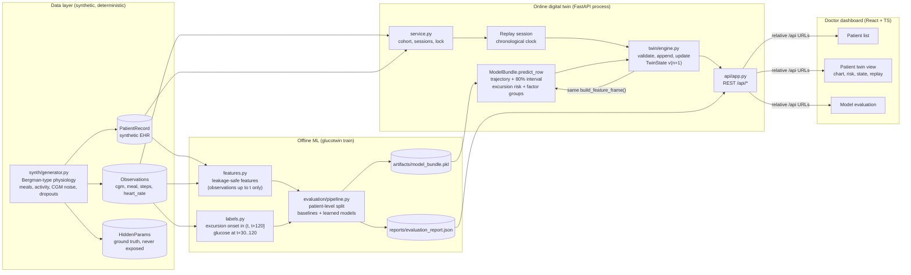
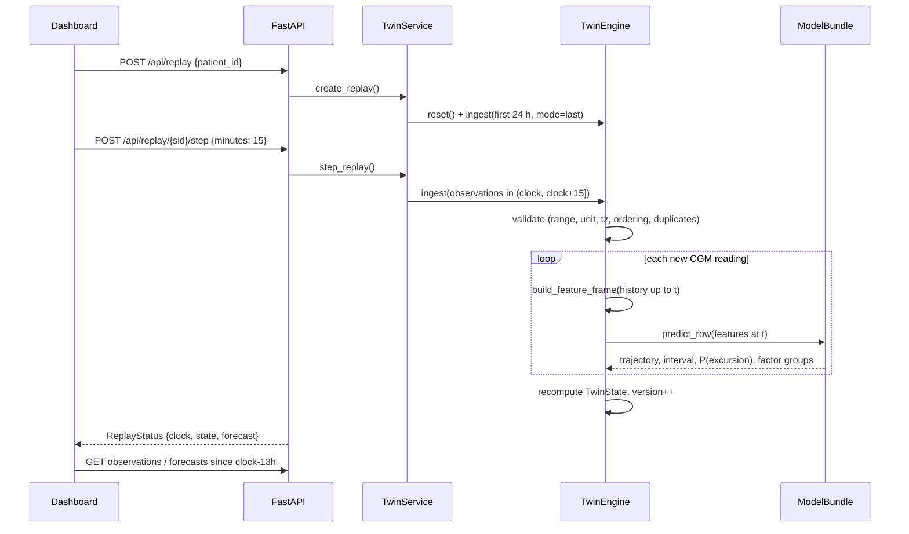

# GlucoTwin architecture (v0.1, frozen 2026-10-17)

GlucoTwin is a single-node research prototype. It has one Python package (`glucotwin`), one
FastAPI process and one React single-page app. There are no microservices, no message broker and no database in
v0.1. The reasons are recorded in [DECISIONS.md](DECISIONS.md).

## End-to-end flow



## Twin update lifecycle



**Triggers.** The twin issues a forecast every time a CGM reading is accepted. It does not forecast
(status `insufficient_data`) when fewer than 6 readings arrived in the last 60 minutes. It reports no
excursion risk when current glucose is already above 180 mg/dL, because the onset question no longer applies.
**Storage.** The latest `Forecast` is kept in full, plus a compact `ForecastSummary` history (up to 5,000 per patient)
for the risk timeline and the overlay of earlier predictions against what actually happened.

## Repository structure

```
src/glucotwin/
  config.py            frozen constants: thresholds, horizons, valid ranges (contract)
  contracts.py         Pydantic schemas shared by every module and mirrored by the frontend
  synth/generator.py   deterministic synthetic cohort (records, observations, hidden params)
  features.py          leakage-safe features + explanation groups (offline and online)
  labels.py            target definitions (excursion onset, trajectory targets)
  dataset.py           supervised table assembly
  models/forecasting.py  baselines (persistence, damped trend, trend rule) + ridge / logistic / HGB
  models/bundle.py     served model bundle: predict_row, model card, save/load
  evaluation/metrics.py  MAE/RMSE/MARD/Clarke, AUROC/AUPRC/Brier, lead time, false-alert episodes
  evaluation/pipeline.py reproducible train -> validate -> test pipeline
  twin/engine.py       patient state engine (ingest, validate, forecast, state)
  service.py           cohort, engines, replay sessions, thread lock
  api/app.py           FastAPI routes under /api (+ serves frontend/dist at /)
  cli.py               glucotwin train | serve | summary
tests/                 pytest suite (contracts, generator, labels, leakage, metrics, engine, API, pipeline)
frontend/              React 19 + TypeScript + Vite + Recharts dashboard
  src/api/types.ts     TypeScript mirror of contracts.py
  src/api/client.ts    typed fetch client (relative URLs only)
  src/components/      PatientView, GlucoseChart, RiskPanel, RiskTimeline, StatePanel, EvaluationView
reports/               evaluation_report.json (generated, committed as evidence)
artifacts/             model_bundle.pkl (generated, git-ignored)
data/                  reserved for optional external datasets (git-ignored, never committed)
docs/                  this documentation set
```

## Module boundaries and dependency rules

| Module | May import | Must not import |
|---|---|---|
| `config`, `contracts` | stdlib, pydantic | anything else in glucotwin |
| `synth` | config, contracts | features, models, api |
| `features`, `labels` | config, contracts | models, api, synth.HiddenParams |
| `models` | config, contracts, features, labels | api, service |
| `evaluation` | all of the above | api |
| `twin` | config, contracts, features, labels, models | api |
| `service` | twin, models, synth, contracts | api |
| `api` | service, contracts, models | (top of the stack) |

The rule that matters most for scientific validity: **hidden simulator parameters never cross into
`features`**. `tests/test_leakage.py::test_hidden_parameters_never_used_as_features` and
`tests/test_generator.py::test_hidden_physiology_not_in_observable_record` enforce it.

## Integration risks and mitigations

| Risk | Mitigation in v0.1 |
|---|---|
| Training/serving feature skew | Online engine calls the same `build_feature_frame`; a parity test compares served and offline forecasts |
| Demo shows patients the model trained on | Service regenerates the exact training cohort from `bundle.cohort_params` and exposes only the `test` split |
| UI revealing future data during replay | Observation and forecast endpoints read from the engine's history (only data up to the replay clock); an API test asserts this |
| Frontend/backend schema drift | `contracts.py` is the single source; `types.ts` mirrors it; `tsc` runs in the build |
| Concurrent requests mutating one engine | Service-wide re-entrant lock around ingest and replay |
