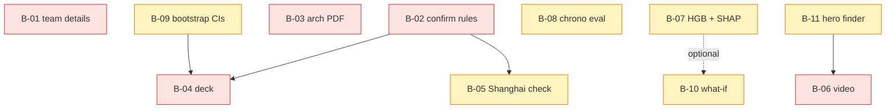

# Prioritised backlog, dependency graph and risk register

**Wave-2 status (2026-10-17):** B-02 DONE (official rules in COMPETITION_COMPLIANCE.md) · B-03 DONE (`docs/submission/GlucoTwin_Architecture.pdf`) · B-04 DONE (`docs/submission/GlucoTwin_Presentation.pdf`; team details filled 2026-10-18) · B-09 DONE (patient-bootstrap CIs, `glucotwin audit`) · B-11 DONE (`scripts/find_demo_scenario.py`) · B-14 partly (pytest CVE fixed; TestClient deprecation remains) · B-01 partly (team details filled 2026-10-18; licence holder open), B-06 BLOCKED on the team. New items: B-19 event-model feature set — investigated 2026-10-20 (docs/ABLATION_RECORD_FEATURES.md, scripts/ablate_record_features.py): ablation reproduced (test AUROC 0.884 → 0.9075 without the record block, Δ CI −0.053..−0.001); mechanism identified (fasting_glucose_mg_dl carries std coef −3.7 against the dynamic evidence); validation does NOT prefer the change (0.8881 vs 0.8866), so the served model is unchanged — re-select across cohort seeds on validation post-submission; B-20 derive synthetic HbA1c from a pre-monitoring period instead of the evaluated window.

Deadline: **20 Oct 2026, 09:30 EDT / 19:00 IST**. P0 = needed for a valid submission; P1 = strongly improves the score;
P2 = after submission (jury round).

## Backlog

| ID | Pri | Item | Owner role | Depends on | Size |
|---|---|---|---|---|---|
| B-01 | P0 | Fill team details, college or incubator, and confirm the licence holder in README / LICENSE — **PARTIAL** — team details filled 2026-10-18; licence-holder confirmation still open (LICENSE says "GlucoTwin contributors", README §16 says "Mohnish Shanmugavadivel"; institutional IP policy unchecked) | Team | – | XS |
| B-02 | P0 | Confirm the official submission guidelines and data rules on Unstop; update COMPETITION.md | G | – | XS |
| B-03 | P0 | Export the architecture diagram to PDF (render the Mermaid in ARCHITECTURE.md) | G | – | S |
| B-04 | P0 | Presentation deck (PDF/PPT) from the outline in COMPETITION.md, using real numbers from the report | G | B-02 | M |
| B-05 | P1 | `scripts/fetch_shanghai_t2dm.py` adapter + 15-min plausibility check (only if the rules allow it) | A + C | B-02 | M |
| B-06 | P0 | Record the **≥ 20-minute** demo video (script: DEMO_SCRIPT.md; hero and failure scenes chosen and verified) | G + E | B-11 | M |
| B-07 | P1 | Serve HGB for the event task with TreeSHAP group attributions; compare faithfulness with the logistic-regression groups | C | – | M |
| B-08 | P1 | Within-patient chronological evaluation with a 120-min embargo (quantifies the value of personalisation) | C | – | S |
| B-09 | P1 | Patient-bootstrap 95% confidence intervals for all reported metrics | C | – | S |
| B-10 | P1 | What-if panel: change meal carbs or a walk and re-simulate on the twin (needs per-patient parameter fitting) PARTIAL (meal counterfactual lab shipped; activity/walk scenario remains P2) | C + D + E | B-07 optional | L |
| B-11 | P1 | "Hero patient" finder script: list test-patient timestamps where risk rose ≥ 60 min before an excursion | C | – | S |
| B-12 | P2 | Late or out-of-order data: re-sort and recompute affected forecasts instead of rejecting | D | – | M |
| B-13 | P2 | Persistence (SQLite) for observations and forecasts if multi-user demos are needed | D | – | M |
| B-14 | P2 | Replace the deprecated httpx TestClient path; add Dockerfile / docker compose | F | – | S |
| B-15 | P2 | Frontend unit tests (Vitest + Testing Library) and code-splitting Recharts | E + F | – | S |
| B-16 | P2 | Hypoglycaemia (< 70) as a second event; simulator calibration for TBR (currently 0.4% vs 2.4% published) | A + C | – | M |
| B-17 | P2 | Sleep stream (duration, awakenings) from the wearable, with its effect on insulin sensitivity in the simulator | A + D | – | M |
| B-18 | P2 | FHIR R4 export of PatientRecord / Observation for interoperability | B + D | – | M |
| B-21 | P2 | Mid-replay connection loss currently replaces the workspace with the full-screen retry card (loud but destructive); make it an inline recoverable banner. Needs browser testing (no browser in the dev sandbox). | E | – | S |
| B-22 | P1 | **DONE 2026-10-20 (reference fix; diagnosis corrected).** The earlier "simulator artifact / meal-response window collision" diagnosis was wrong: the what-if uses the served ML models (not the simulator), the hypothetical meal never changes the learned carb sensitivity, and the recorded case (20 g → −12.0 vs 60 g → +41.1) did not reproduce. Cause: logging any meal resets `minutes_since_meal`, and the models learned that a long gap anticipates a meal/excursion, so "vs no meal" removes an anticipated meal (Δ+60 < −2 mg/dL in 15.3% of 5 g scenarios; Δrisk < −0.01 in 29.8%). Fix (no model change): primary comparison = scenario − **zero-carb meal at the same time** (0 material negatives in Δ+60/Δrisk for ≥ 30 g); the no-meal comparison stays as a labelled secondary; meals < 30 g flagged unreliable; risk changes greyed when starting risk > 0.95. Evidence: `scripts/counterfactual_audit.py` → `reports/counterfactual_audit.json`; tests: `tests/test_counterfactual_reference.py`. Remaining: the reference itself is unseen in training (min training meal 6 g); Δ+60 is non-decreasing in meal size at 294/326 points. Post-submission: an intervention-capable model (e.g. per-patient mechanistic fit). | D | – | M |

## Dependency graph (what can run in parallel next)

**Ready to start in parallel now (no blockers):** B-01, B-02, B-03, B-07, B-08, B-09, B-11, B-14, B-15.
File ownership for parallel work: C owns `src/glucotwin/models|evaluation`; D owns `twin|service|api`; E owns `frontend/`;
G owns `docs/`; F owns `tests/` conventions (any agent adds tests for its own module). Changes to `contracts.py` or `config.py`
go through B (the architect) with a schema version bump.

## Risk register

| # | Risk | Likelihood | Impact | Mitigation |
|---|---|---|---|---|
| R1 | Deadline in 3 days; video, deck and PDF not yet produced | High | **Critical** | P0 items are small and parallel; the code is already demo-ready |
| R2 | Official data rules or guidelines differ from what other teams describe | Medium | High | B-02 first; synthetic-only design is the safest default |
| R3 | Jury perceives synthetic results as overclaiming | Medium | High | Disclaimers everywhere; explicit "upper bound" framing; compare with literature; show baselines |
| R4 | Simulator too predictable (30-min RMSE 10.4 vs about 17–20 in real-data literature) | High | Medium | State it; add realism (unlogged meals are already 10%; more meal-timing noise and sensor artefacts); B-05 real-data check |
| R5 | Logistic-regression explanations unintuitive on correlated features | Medium | Medium | Grouped contributions (done); B-07 TreeSHAP comparison |
| R6 | Small held-out set (12 patients), so metrics vary by split | High | Medium | B-09 bootstrap CIs; report prevalence by split |
| R7 | Pickle bundle loading | Low | Medium | Local-only artefacts, documented; switch to skops/ONNX if distributed |
| R8 | Lows under-represented (TBR 0.4%) | High | Low (hyper is the target) | B-16 |
| R9 | No auth on the API | Low (local demo) | High if deployed | Documented; not for real data |

Ingest invariance (chunk-size batching, duplicate re-delivery, session supersede, step-past-end clamping) is pinned by tests since 2026-10-20 (`tests/test_engine_invariance.py`, `tests/test_api.py`).
